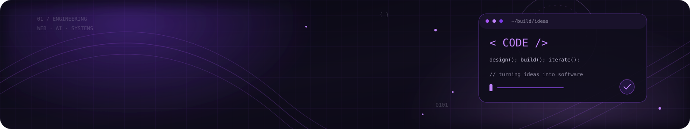
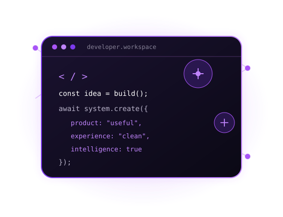
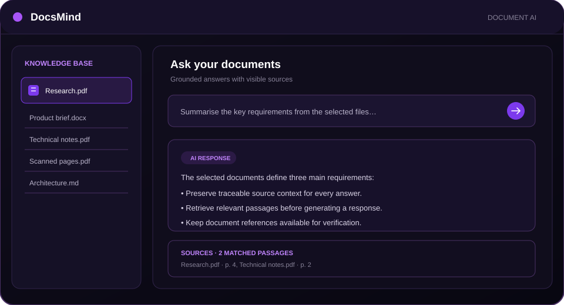
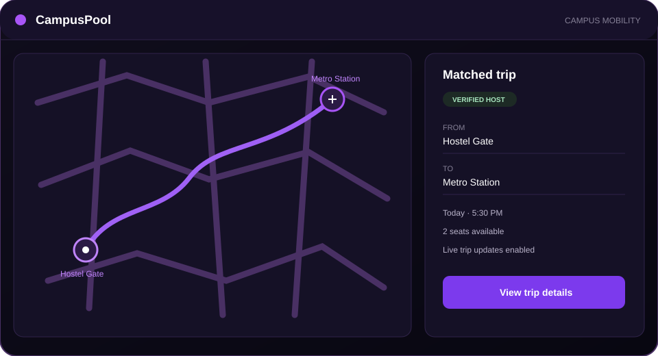
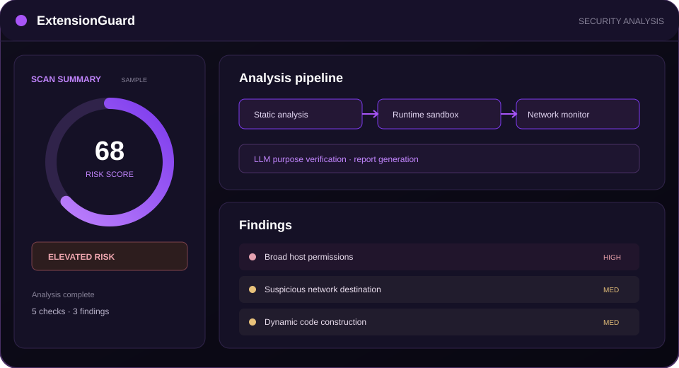
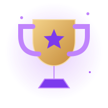

  

<table width="100%">
  <tr>
    <td width="17%" align="center" valign="middle">
      
    </td>
    <td width="55%" valign="middle">
      <h1>Aditya Mishra</h1>
      <h3>Full Stack Developer <code>|</code> AI Engineer</h3>
      
Building modern web applications and intelligent AI-powered solutions with a focus on clean architecture, thoughtful user experience, and real-world impact.

      
<strong>CODE</strong> &nbsp;·&nbsp; <strong>BUILD</strong> &nbsp;·&nbsp; <strong>INNOVATE</strong>

    </td>
    <td width="28%" align="center" valign="middle">
      
    </td>
  </tr>
</table>

  
  &nbsp;
  
  &nbsp;
  
  &nbsp;
  

  📍 Greater Noida, Uttar Pradesh, India &nbsp;·&nbsp; B.Tech Information Technology @ Gautam Buddha University

---

## 01 / About Me

<table width="100%">
  <tr>
    <td width="68%" valign="top">
      I'm a **B.Tech Information Technology student and Full Stack Developer** with a growing focus on Artificial Intelligence. I enjoy building scalable web applications, designing reliable backend systems, exploring AI technologies, and turning ideas into practical products.

      **Core interests**
      
 &nbsp; Full-stack development

      
 &nbsp; Artificial Intelligence, RAG, and AI-powered applications

      
 &nbsp; Backend engineering and API architecture

      
 &nbsp; Clean code, performance, and UI/UX

      
 &nbsp; Product development and practical problem-solving

    </td>
    <td width="32%" valign="middle" align="center">
      
    </td>
  </tr>
</table>

---

## 02 / Tech Stack

<strong>Programming Languages</strong>

  

<strong>Frontend Development</strong>

  

<strong>Backend Development</strong>

  
  

<strong>Databases &amp; Storage</strong>

  
  

<strong>AI / Machine Learning</strong>

  
  
  
  

<strong>Developer Tools</strong>

  
  

TypeScript, Fastify, PostgreSQL, and Playwright are included because they are used in the public ExtensionGuard / DocsMind project stack.

---

## 03 / Featured Projects

Original vector illustrations created for this profile; these are conceptual previews, not captured product screenshots.

<table width="100%">
  <tr>
    <td width="39%" valign="top">
      
    </td>
    <td width="61%" valign="top">
      <h3>DocsMind</h3>
      
<strong>AI Document Intelligence · Hybrid RAG</strong>

      
An intelligent document analysis platform for retrieving useful information from long, scanned, and unstructured documents.

      
<strong>STACK</strong> &nbsp; FastAPI · React · Qdrant · Redis · OCR · LangGraph · PostgreSQL

      - OCR-powered document extraction and intelligent chunking. 
      - Hybrid retrieval with context-aware question answering. 
      - Streaming AI responses with source citations. 
      - Document preview and verifiable answers.
      
<a href="https://github.com/adimishra-code/docsmind"><strong>Repository ↗</strong></a> &nbsp;·&nbsp; <a href="https://docsmind-beige.vercel.app/"><strong>Live application ↗</strong></a>

    </td>
  </tr>
</table>

<table width="100%">
  <tr>
    <td width="39%" valign="top">
      
    </td>
    <td width="61%" valign="top">
      <h3>CampusPool</h3>
      
<strong>Verified Campus Ride-Sharing Platform</strong>

      
A student-focused carpooling platform designed to make campus transportation safer, easier, and more organised.

      
<strong>STACK</strong> &nbsp; MongoDB · Express.js · React · Node.js · JWT · Socket.IO · Google Maps

      - Student verification and role-based access control. 
      - Route-based ride matching and trip management. 
      - Real-time trip updates, chat, and notifications. 
      - Campus-aware safety tools and peer-to-peer cost sharing.
      
<a href="https://github.com/adimishra-code/campuspool"><strong>Repository ↗</strong></a> &nbsp;·&nbsp; <a href="https://campuspool.pages.dev/"><strong>Live platform ↗</strong></a>

    </td>
  </tr>
</table>

<table width="100%">
  <tr>
    <td width="39%" valign="top">
      
    </td>
    <td width="61%" valign="top">
      <h3>ExtensionGuard</h3>
      
<strong>Browser Extension Security Auditing</strong>

      
A browser extension security platform combining static analysis, isolated runtime inspection, network monitoring, and LLM-assisted risk assessment.

      
<strong>STACK</strong> &nbsp; React · TypeScript · Fastify · PostgreSQL · Redis · Playwright

      - Static AST analysis and detection of 50+ risky Chrome APIs. 
      - Sandboxed execution and network-exfiltration monitoring. 
      - LLM-assisted purpose verification and permission analysis. 
      - Risk scoring from 0–100 with structured security reports.
      
<a href="https://github.com/adimishra-code/extensionguard"><strong>Repository ↗</strong></a> &nbsp;·&nbsp; <a href="https://extensionguard-web.onrender.com/"><strong>Live scanner ↗</strong></a>

    </td>
  </tr>
</table>

---

## 04 / Experience &amp; Education

<table width="100%">
  <tr>
    <td width="50%" valign="top">
      <h3>Professional Experience</h3>
      **Full Stack Developer Intern** 
      **Skypath Global** · Remote 
      August 2026 – Present · Three-month paid internship
      - Contributed to **OMBREILLE**, a multi-service platform spanning aviation courses, hospitality courses, and real-estate services.
      - Worked on property listings, online property workflows, and platform administration features.
      - Contributed to **EduPulse**, an educational platform presenting academic and professional program listings.
      - Participated in real-world web application development.
    </td>
    <td width="50%" valign="top">
      <h3>Education</h3>
      **Gautam Buddha University** 
      **B.Tech · Information Technology** 
      2024 – Present · Greater Noida, Uttar Pradesh
      **Relevant coursework**
      - Data Structures &amp; Algorithms
      - Object-Oriented Programming
      - Database Management Systems
      - Operating Systems &amp; Computer Networks
      - Software Engineering
    </td>
  </tr>
</table>

---

## 05 / Achievements &amp; Learning

<table width="100%">
  <tr>
    <td width="20%" valign="middle" align="center">
      
    </td>
    <td width="80%" valign="top">
      - **Top 25 Teams** — Tech Tank, IgNITion Techfest 2025, Gautam Buddha University.
      - **Advanced Software Engineering Job Simulation** — Walmart Global Tech (Forage).
      - **NxtWave Intensive AI Bootcamp** — 2026.
      - **AI/ML Workshop** — Nokia, organised by TSSC Noida.
      - **IgNITion Techfest 2025** — Gautam Buddha University.
      - **Ignition Hackathon 2.0** — Gautam Buddha University, 2026.
      - **Organising Committee Member** — Intra-Institutional AI Hackathon.
    </td>
  </tr>
</table>

### Currently Exploring

`Advanced AI Applications` &nbsp; `Agentic AI` &nbsp; `LangGraph Workflows` &nbsp; `Scalable Backend Architecture` &nbsp; `Advanced DSA`

---

## 06 / GitHub Activity

  
  

  
  

  

  

Statistics and counts are loaded dynamically from GitHub and third-party chart services. Temporary service limits may affect card availability; no statistics are hardcoded in this README.

---

## 07 / Developer Philosophy

> Great software isn't just about writing code. It's about solving meaningful problems, creating seamless experiences, and building systems that people can rely on.

---

## 08 / Let's Connect

  <h3>Have an interesting idea or project?</h3>
  
Let's build something meaningful together.

  
  &nbsp;
  
  &nbsp;
  
    
  Designed with curiosity and built with intent · Aditya Mishra

