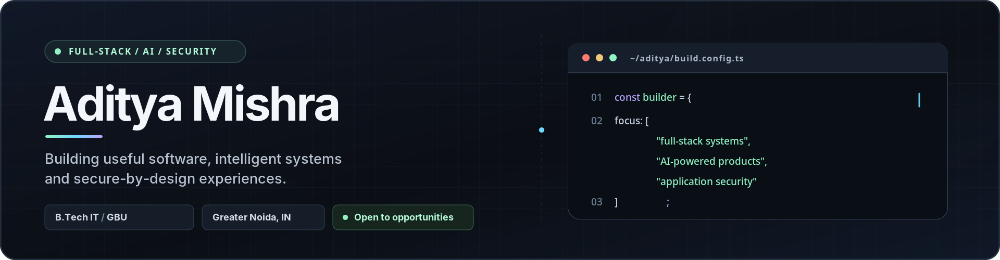

  

  

    <a href="https://portfolio-adiimishraa.vercel.app/">Portfolio</a>
    &nbsp;·&nbsp;
    <a href="https://www.linkedin.com/in/adi-mishraa/">LinkedIn</a>
    &nbsp;·&nbsp;
    <a href="https://github.com/adimishra-code">GitHub</a>
    &nbsp;·&nbsp;
    <a href="mailto:adityamishrav820@gmail.com">Email</a>
  

  

    
    
  

---

## `01` &nbsp; About

I'm **Aditya Mishra**, a B.Tech Information Technology student at **Gautam Buddha University** and a full-stack developer interested in the engineering behind useful, dependable software.

I enjoy taking products from idea to implementation — shaping the interface, designing APIs, working with data, integrating AI workflows, and thinking through deployment and security. My current work sits at the intersection of **full-stack engineering, AI-powered systems, and application security**.

- **Build:** Full-stack web applications, backend services, and developer-focused tools.
- **Explore:** AI agents, retrieval systems, LLM applications, and secure execution environments.
- **Approach:** Practical architecture, readable code, thoughtful UX, and features that solve real problems.

---

## `02` &nbsp; Selected Work

<table width="100%">
  <tr>
    <td width="50%" valign="top">
      <h3>01 · Extension Guard</h3>
      
<strong>Browser Extension Security Scanner</strong>

      
A five-stage scanner combining static AST analysis with sandboxed Chromium execution through Playwright. Designed to identify potential data exfiltration, privilege-escalation paths, and malicious dynamic code.

      
<strong>STACK</strong> &nbsp; TypeScript · Fastify · Playwright · PostgreSQL · Redis

      
<a href="https://extensionguard-web.onrender.com/"><strong>Live scanner ↗</strong></a> &nbsp;·&nbsp; <a href="https://github.com/adimishra-code/extensionguard"><strong>Source code ↗</strong></a>

    </td>
    <td width="50%" valign="top">
      <h3>02 · DocsMind</h3>
      
<strong>Document Intelligence &amp; Hybrid RAG</strong>

      
A document intelligence platform combining dense vector retrieval with BM25 keyword search, cross-encoder reranking, and LangGraph-based multi-step reasoning.

      
<strong>STACK</strong> &nbsp; Python · FastAPI · LangGraph · Qdrant · React · Redis

      
<a href="https://docsmind-beige.vercel.app/"><strong>Live application ↗</strong></a>

    </td>
  </tr>
  <tr>
    <td width="50%" valign="top">
      <h3>03 · Sentinel</h3>
      
<strong>Multi-tenant AI Trust &amp; Safety Platform</strong>

      
A moderation platform for English, Hindi, and Hinglish, with configurable policy evaluation, risk scoring, and audit trails.

      
<strong>STACK</strong> &nbsp; Node.js · Fastify · FastAPI · MongoDB · Gemini API

      

    </td>
    <td width="50%" valign="top">
      <h3>04 · CampusPool</h3>
      
<strong>Peer-to-peer Campus Transit Network</strong>

      
A peer-to-peer campus ride-sharing platform with weighted rider–driver route matching, real-time location updates over Socket.IO, institutional email verification, and SOS safety triggers.

      
<strong>STACK</strong> &nbsp; React · Node.js · MongoDB · Socket.IO · Redux Toolkit

      
<a href="https://campuspool.pages.dev/"><strong>Live platform ↗</strong></a>

    </td>
  </tr>
</table>

  
<strong>More projects &amp; collaborative work</strong>

   

  **JARVIS / Chitragupta** — A modular desktop AI assistant with dynamic tool routing, tiered memory, voice activation, and permission-gated execution using FastAPI and Ollama.

  **Tally** — A warehouse inventory management system built around an append-only transaction ledger, multi-tenant role-based access control, and background queue workers.

  **Client platforms · Skypath Global** — Contributed responsive interfaces and backend integrations for **EduPulse Academy**, an education platform, and **OMBREILLE**, a hospitality brand website.

---

## `03` &nbsp; Tech Stack

<strong>Languages</strong>

  

<strong>Frontend</strong>

  

<strong>Backend, APIs &amp; Data</strong>

  

<strong>AI &amp; Retrieval</strong>

  
  
  
  
  

<strong>Developer Tools &amp; Infrastructure</strong>

  

---

## `04` &nbsp; Experience &amp; Education

<table width="100%">
  <tr>
    <td width="24%" valign="top"><strong>2026</strong></td>
    <td valign="top">
      <strong>Full Stack Developer Intern · Skypath Global</strong> 
      Contributed full-stack features and API integrations across client platforms, including EduPulse Academy and OMBREILLE.
    </td>
  </tr>
  <tr>
    <td width="24%" valign="top"><strong>2024 – Present</strong></td>
    <td valign="top">
      <strong>B.Tech · Information Technology</strong> 
      Gautam Buddha University, Greater Noida
    </td>
  </tr>
</table>

---

## `05` &nbsp; Certifications &amp; Highlights

- **Walmart Global Tech · Advanced Software Engineering Job Simulation (Forage)** — Backend services, relational data modeling, and performance-focused engineering tasks in Java.
- **NxtWave · Intensive AI Bootcamp (2026)** — Neural network fundamentals, prompt engineering, and LLM agent orchestration.
- **Nokia &amp; TSSC Noida · AI/ML Technical Workshop** — Practical exposure to predictive modeling and machine learning applications in telecommunications.
- **IgNITion Techfest · Gautam Buddha University** — Top 25 finalist in Tech Tank (2025); Hackathon 2.0 participant (2026).
- **Intra-Institutional AI Hackathon** — Organizing Committee Member.

---

## `06` &nbsp; GitHub Activity

  
  &nbsp;
  

---

  <h3>Let's build something meaningful.</h3>
  
Have an interesting engineering problem, project, or opportunity?

  <a href="mailto:adityamishrav820@gmail.com"><strong>Get in touch ↗</strong></a>
    
  Designed and built with curiosity · Aditya Mishra

